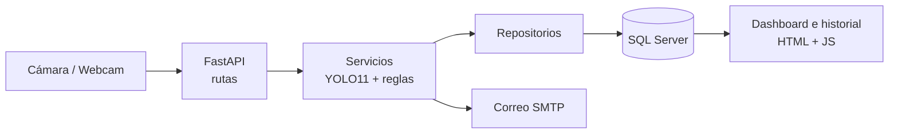

# 🛡️ Urban Anomaly AI (SecurityAPPCR)


Sistema de monitoreo con **visión artificial** que analiza la imagen de una cámara en tiempo real, detecta personas y objetos con **YOLO11**, evalúa reglas de seguridad y genera **alertas automáticas** con captura de evidencia y envío por correo.

Proyecto académico del curso **BD-141 Big Data** · Colegio Universitario de Cartago (CUC).

---

## 👥 Proyecto en equipo y mi aporte

Proyecto desarrollado en equipo. Repositorio original del equipo: [andreyac1397/SecurityAppCR_Bigdata](https://github.com/andreyac1397/SecurityAppCR_Bigdata).

**Mi aporte (Jeremy Ramírez Pérez):**
- Entrené y ajusté modelos de detección con **YOLO**.
- Desarrollé la detección de **objetos abandonados**: el sistema genera una alerta cuando un objeto permanece en cámara más del tiempo configurado y cumple los criterios de visión definidos.

---

## 🚨 Qué detecta

| Anomalía | Cómo se decide |
|---|---|
| Aglomeración | Conteo de personas por encima del límite configurado |
| Permanencia prolongada | Una misma persona en cámara más de N segundos |
| Zona restringida | Persona dentro de un área marcada en la imagen |
| Fuera de horario | Presencia fuera del horario permitido |
| **Objeto abandonado** | Mochila, bolso o maleta sin ninguna persona cerca durante N segundos |
| Caída | Caja de la persona más ancha que alta (postura horizontal) durante un tiempo configurado |
| Fuego | Modelo YOLO entrenado para fuego (`best_nano_111.pt`) |
| Estado de la cámara | Cámara apagada o con falla |

Cada alerta guarda una captura, queda en el historial y se envía por correo a los destinatarios configurados, con un tiempo de espera (cooldown) para no repetir avisos.

### 🎒 Cómo funciona la detección de objetos abandonados

1. YOLO11 detecta mochilas, bolsos y maletas (clases COCO 24, 26 y 28) con un umbral de confianza propio para objetos, más bajo que el de personas.
2. Cada objeto recibe un identificador y se sigue entre cuadros por la distancia de su centro (`seguimiento_objetos_servicio.py`).
3. Para cada objeto se mide cuántos segundos lleva **sin ninguna persona cerca**.
4. Si supera el tiempo configurado, se genera la alerta `OBJETO_ABANDONADO` con nivel ALTO (`objeto_abandonado_servicio.py`).

## 🏗️ Arquitectura



---

## 🧰 Tecnologías

- Python 3.13
- FastAPI
- YOLO11n
- OpenCV
- SQL Server
- Jinja2
- HTML
- CSS
- JavaScript

---

## 📁 Estructura principal

```text
SecurityAPPCR/
│
├── backend/
│   ├── main.py
│   ├── configuracion.py
│   ├── base_datos.py
│   │
│   ├── modelos/
│   ├── rutas/
│   ├── servicios/
│   ├── repositorios/
│   ├── utilidades/
│   │
│   └── recursos/
│       ├── capturas/
│       ├── correos_simulados/
│       └── modelo_yolo/
│
├── database/
│   ├── 01_crear_base_datos.sql
│   ├── 02_crear_tablas.sql
│   ├── 03_crear_procedimientos.sql
│   └── 04_insertar_datos_iniciales.sql
│
├── frontend/
│   ├── templates/
│   ├── css/
│   ├── js/
│   └── imagenes/
│
├── documentacion/
├── pruebas/
│
├── .env.example
├── requirements.txt
└── README.md
```

### Partes principales

| Carpeta | Función |
|---|---|
| `backend/modelos` | Define y valida los datos utilizados por la aplicación. |
| `backend/rutas` | Contiene los endpoints de la API. |
| `backend/servicios` | Ejecuta la detección, reglas, alertas y envío de correos. |
| `backend/repositorios` | Gestiona las consultas y operaciones con la base de datos. |
| `backend/recursos` | Guarda el modelo YOLO, capturas y correos simulados. |
| `database` | Contiene los scripts para preparar SQL Server. |
| `frontend/templates` | Contiene las páginas y el layout compartido de Jinja2. |
| `frontend/js` | Controla la cámara, API, historial y destinatarios. |
| `frontend/css` | Contiene los estilos generales y del monitoreo. |
| `pruebas` | Contiene pruebas de detección, reglas, correo e integración. |

---

# ▶️ Ejecución del sistema

## Fase 1 — Clonar el repositorio

```bash
git clone https://github.com/jeremyramirezperez-ui/Urban-Anomaly-AI.git
```

```bash
cd Urban-Anomaly-AI
```

## Fase 2 — Crear el entorno virtual

```bash
py -3.13 -m venv venv
```

### Activar en CMD

```cmd
venv\Scripts\activate
```

### Activar en PowerShell

```powershell
.\venv\Scripts\Activate.ps1
```

## Fase 3 — Instalar dependencias

```bash
python -m pip install --upgrade pip
```

```bash
python -m pip install -r requirements.txt
```

## Fase 4 — Preparar SQL Server

Ejecutar en SQL Server Management Studio, respetando este orden:

```text
database/01_crear_base_datos.sql
database/02_crear_tablas.sql
database/03_crear_procedimientos.sql
database/04_insertar_datos_iniciales.sql
```

## Fase 5 — Configurar variables de entorno

Crear el archivo `.env` desde el ejemplo:

```cmd
copy .env.example .env
```

Completar en `.env` la conexión de SQL Server y la configuración del correo.

> El archivo `.env` contiene información privada y no debe subirse a GitHub.

## Fase 6 — Descargar el modelo

Si `yolo11n.pt` no está disponible:

```bash
python backend/recursos/modelo_yolo/descargar_modelo.py
```

## Fase 7 — Ejecutar la aplicación

```bash
python -m uvicorn backend.main:app --reload
```

Abrir en el navegador:

```text
http://127.0.0.1:8000
```
